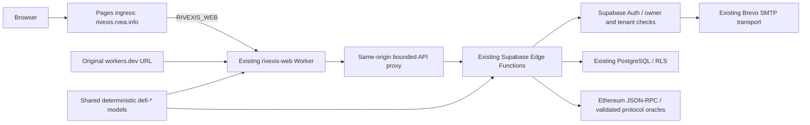

# Architecture

The existing npm monorepo remains authoritative. Moving functioning modules into a new directory hierarchy would add deployment risk without changing their responsibilities.

| Layer | Actual source | Responsibility |
|---|---|---|
| Presentation | `apps/web/app`, `apps/web/components` | Existing landing, workspace, forms, charts and Settings |
| Application | Existing web providers/hooks and `apps/web/lib/api.ts` | Session state, request ownership, drafts, navigation and account workflow |
| Domain | `supabase/functions/rivexis-api/defi-*model.mjs`, liquidation/sequence modules | Fixed-point accounting, scenarios and bounded planning |
| Integration | `defi-*rpc.mjs`, `onchain-http.mjs`, Edge function entrypoints | Block-pinned evidence, quotas, storage and authorization |
| Infrastructure | Root/app Wrangler files, `infrastructure/rvea-pages-gateway`, `.github/workflows` | Same Worker, ingress, builds, release checks and rollback |
| Retained backend | `apps/api`, `apps/api/cloudflare` | Python/Alembic history and tested legacy capabilities; not the current Supabase DeFi API deployment target |

The personal Wix root/WWW portfolio is a separate application and DNS dependency. GitHub Pages contains a redirect to the same Worker, not another financial application. The retired Supabase recovery relay returns410; its ACTIVE deployment metadata does not mean its former capability remains enabled.

Current limitations and consolidation findings are in [the governance report](docs/governance/ENGINEERING_GOVERNANCE_REPORT.md). Historical design decisions remain in `docs/adr` and `docs/ARCHITECTURE_DECISIONS.md`.
