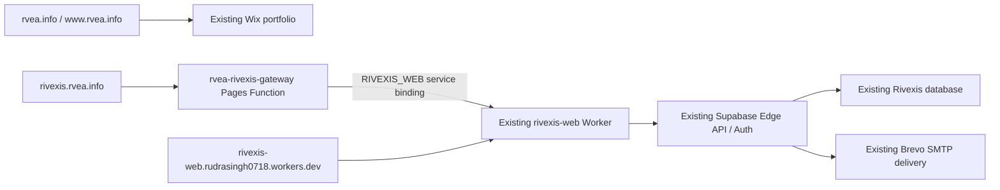

# RVEA / RIVEXIS production runbook

Verified application checkpoint: **29 October 2026**; documentation finalized **30 October 2026** (Asia/Kolkata). This records the deployed architecture and the acceptance checks actually completed. Recheck live settings before a later change; IDs below identify this release rather than an instruction to deploy an old version.

## Architecture and boundaries



Wix remains the DNS authority and keeps its existing site assignment. The Pages project is an ingress to the existing application, not a second RIVEXIS application or database. This execution created no paid resource, changed no nameserver and performed no trade, wallet signature or transaction.

| Resource | Verified value |
|---|---|
| Wix site | `35246fe9-12e6-45c0-84ef-2f93f7697986` |
| Cloudflare account | `0b22778ba197266a58dd26eeef0334a8` |
| Existing Worker | `rivexis-web` |
| Pages project | `rvea-rivexis-gateway` |
| Production Pages deployment | `b8357b8b-3895-449f-9f68-39fa0a92f39a` |
| Accepted isolated preview | `9f3632ba-0cf5-44df-9de1-9c04e593b3f9` |
| Accepted application Worker version | `3d4ce72d-5832-461a-bcfc-c95c16337463` |
| Accepted application commit at this checkpoint | `b47cb5942c15a6a5616b97ea2a666edbc2600b36` |
| Supabase project | `ivszvufdonfgwjpfgwii` (`Rivexis`, `ap-south-1`) |

The pending Full Cloudflare zone `af74f9f2c1d47209440a0756b251af9f` remains inactive. Its staged DNS is not authoritative. Do not activate or delete it as a troubleshooting experiment.

## DNS and TLS

The authoritative Wix zone has these routing records:

| Type | Name | Value | TTL (seconds) |
|---|---|---|---|
| A | `rvea.info` | `185.230.63.171`, `185.230.63.186`, `185.230.63.107` | 3600 |
| CNAME | `www.rvea.info` | `cdn3.wixdns.net` | 3600 |
| CNAME | `rivexis.rvea.info` | `rvea-rivexis-gateway.pages.dev` | 3600 |
| NS | `rvea.info` | `ns4.wixdns.net`, `ns5.wixdns.net` | 86400 |

Only the `rivexis` CNAME was added. Root/WWW records and Wix assignment were preserved. Do not replace, unassign or transfer the root domain to connect an application subdomain; the earlier nameserver/unassignment attempt caused a Wix 404 and was rolled back.

The custom hostname was associated in **Pages > Custom domains before the Wix CNAME**. Cloudflare now reports **Active / SSL enabled**. A subdomain can use Pages with an external DNS provider; an apex Pages deployment would require a different zone setup. If a future UI asks to activate the pending zone, change nameservers or automatically edit Cloudflare DNS, stop that flow and use the documented external-DNS subdomain path. Do not treat a record in the pending zone as a Wix DNS change. See [Cloudflare custom-domain documentation](https://developers.cloudflare.com/pages/configuration/custom-domains/).

Normal local DNS and HTTPS checks passed at 09:04 UTC on 29 October, after earlier local NXDOMAIN caching. `rvea.info` redirected once to `https://www.rvea.info/`; WWW, custom RIVEXIS and the original Worker returned 200 with normal TLS validation. The two RIVEXIS landing responses had identical hashes and the full expected build SHA. This is an observed checkpoint, not proof of availability at every resolver or time.

## Gateway configuration and deployment

Sources: [gateway configuration](../infrastructure/rvea-pages-gateway/wrangler.jsonc), [gateway implementation](../infrastructure/rvea-pages-gateway/public/_worker.js), [gateway workflow](../.github/workflows/rvea-pages-gateway-preview.yml).

- Pages Advanced Mode serves `public/_worker.js`; `pages_build_output_dir` is `./public`.
- `RIVEXIS_WEB` binds to the existing `rivexis-web` service in the same account.
- Gateway compatibility date is `2026-10-28`; repository Wrangler is pinned to `4.148.0`.
- Only exact `rivexis.rvea.info` receives production behavior. The fixed Pages hostnames permit unauthenticated GET/HEAD reads; API, cookie/authorization-bearing and write requests return 403.
- A missing binding returns 503. Binding transport failures return a sanitized 502. The gateway never retries a write whose upstream outcome may be unknown.
- Pages production **Fail closed** is a dashboard runtime setting. It was read back after deployment and persisted. It is not a supported key in this Wrangler file. Recheck it after each deployment; never select fail open for authenticated traffic. See [Pages routing behavior](https://developers.cloudflare.com/pages/functions/routing/#fail-open--closed).

The workflow accepts only `main` and the exact historical `infra/rvea-pages-gateway-20261029` branch. A manually dispatched unrelated branch is skipped. The infrastructure branch creates a preview; `main` deploys production. It tests ingress before exposing credentials, requires successful existing-Worker inspection and validates a raw scoped token. With pinned Wrangler, Pages inventory uses `Project Name`; `--force` on Pages creation/deployment prevents automatic Worker delegation. Preserve those details when upgrading the CLI.

For a gateway change:

1. Review the binding target and exact hostname guards; run `node --test infrastructure/rvea-pages-gateway/gateway.test.mjs`.
2. Review a preview-capable branch/workflow change if a new branch is needed; do not widen the deployment guard casually. Deploy an isolated preview through the approved workflow and use the actual preview URL returned by Wrangler.
3. Verify real landing content, assets and deep links separately from `/__rvea_gateway_status`, which only reports ingress/binding configuration. Confirm private/API/write/cookie requests fail on preview.
4. Merge reviewed passing source to `main`, observe the production deployment and re-read binding, Fail closed and Custom domains settings.
5. Recheck custom-host DNS/TLS, authenticated behavior and the direct original Worker. Record commit, Pages deployment ID, Worker version, time and test results without credentials.

## Credentials and public configuration

Keep credential values only in their existing encrypted stores. Do not paste them into source, command output, screenshots, PRs or run logs. These are names and scopes, not credential values:

| Store / name | Purpose and verified setting |
|---|---|
| GitHub secret `CLOUDFLARE_PAGES_API_TOKEN` | Cloudflare Pages Edit + Workers Scripts Read on the existing account; expires **29 October 2027** |
| GitHub secret `CLOUDFLARE_API_TOKEN` | Workers Scripts Edit on the existing account; expires **29 October 2027** |
| GitHub secret `CLOUDFLARE_ACCOUNT_ID` | Existing production deployment account ID; not a bearer credential |
| GitHub variable `RIVEXIS_PUBLIC_WEB_URL` | `https://rivexis.rvea.info` |
| Cloudflare Builds `NEXT_PUBLIC_RIVEXIS_PUBLIC_WEB_URL` | `https://rivexis.rvea.info` |
| Supabase Edge secret `RIVEXIS_PUBLIC_WEB_URL` | `https://rivexis.rvea.info`; public origin for email links |

Both Cloudflare tokens were created on 29 October 2026. Rotate securely before expiry: create the same account-scoped replacement, update the appropriate encrypted GitHub secret, run its existing preflight/deployment verification, then revoke the superseded token. Keep Pages and Worker credentials separate. No token value belongs in this runbook.

The manual [deploy-web workflow](../.github/workflows/deploy-web.yml) builds with:

```text
NEXT_PUBLIC_RIVEXIS_API_URL=same-origin
NEXT_PUBLIC_RIVEXIS_PUBLIC_WEB_URL=<GitHub RIVEXIS_PUBLIC_WEB_URL variable>
NEXT_PUBLIC_RIVEXIS_BUILD_SHA=<full GitHub deployment commit SHA>
```

`NEXT_PUBLIC_` values enter browser output; never place private Supabase or SMTP credentials there. The repository variable retains the original Worker origin as the workflow fallback if unset, but production is currently set to the custom origin. [The origin guard](../apps/web/scripts/check-deploy-env.mjs) must pass before a build.

Deploy web source by selecting the reviewed `main` revision in `deploy-web`, not an arbitrary branch. The workflow installs locked dependencies, typechecks, builds and deploys the existing Worker, then checks the build marker, full expected SHA and landing phrase. Do not remove the full-SHA check. The large-response SIGPIPE false failure was fixed in [PR #121](https://github.com/rudras777/rivexis/pull/121); successful run [40846085911](https://github.com/rudras777/rivexis/actions/runs/40846085911) completed at 09:00:20 UTC.

## Supabase Auth, email and recovery

In the **existing** Supabase project, Auth Site URL is exactly:

```text
https://rivexis.rvea.info
```

The dashboard readback has exactly three redirect allowlist entries:

```text
https://rivexis-web.rudrasingh0718.workers.dev/**
https://rivexis.rvea.info/login?verified=1
https://rivexis.rvea.info/reset-password
```

Keep the legacy callback during this migration. Do not add a wildcard custom-domain callback or replace the legacy callback without a reviewed requirement. API CORS permits the reviewed custom and legacy origins; foreign-origin login POST was verified to fail with 403. Same-origin requests continue through the Worker proxy.

The exact deployed HTML fragments are versioned as:

- [Confirm signup](../supabase/templates/confirmation.html)
- [Reset password](../supabase/templates/recovery.html)

They are public template sources, **not automatically applied by a merge or Edge deployment**. For a later approved template change, open the existing project's Auth Email Templates settings, capture the current complete content securely, paste the complete corresponding fragment, save, reopen and compare the entire value. Keep the current SMTP credentials/sender unchanged. Test only explicitly approved recipient addresses and retain sanitized results. [Supabase documents the variables and hosted-template editor](https://supabase.com/docs/guides/auth/auth-email-templates).

**Confirmation:** the old one-use `ConfirmationURL` flow produced an already-confirmed account followed by an expired-link page through tracked email links. Prefetching and replay are possible explanations; the exact cause was not established. The deployed template now includes `{{ .Token }}` and a static `{{ .SiteURL }}/verify-email` link. The user enters their email and code; the existing frontend POSTs to `/api/v1/auth/email-verification/confirm`. Merely opening the static page does not redeem a token. A fresh approved signup completed this OTP form in the browser and then passed login/me/session checks.

**Recovery:** the template uses `{{ .RedirectTo }}?token_hash={{ .TokenHash }}&amp;type=recovery`, preserving the app-selected, allowlisted reset destination. It does not link to Supabase's GET verification endpoint. The reset page captures the hash in memory, removes credential query parameters and the URL fragment, and waits for the password form submission. The confirmation POST redeems the recovery token, updates the password, globally signs out sessions and clears the application cookie. Existing access JWTs can remain valid until their expiry; session revocation is not a claim of immediate invalidation of every issued JWT.

At 09:30 UTC the real delivered recovery link reached the exact first-party reset page. Opening it twice cleared the URL and displayed the form without redeeming the token. The native integration POST to the same endpoint returned 200, `updated` and `sessions_revoked`; a new-password login passed. At 09:32 UTC replaying the same hash returned 400 invalid/expired, and the first new password still logged in. **Browser password submission was not performed** because of the browser interaction policy; form handoff and native endpoint integration were separately verified. No recovery URL, password, token or private QA recipient is stored here.

Brevo-delivered signup/recovery messages were received by the approved recipients with SPF, DKIM and DMARC passing. Click tracking remained observable. The static confirmation page and deferred recovery POST avoid redeeming credentials on a GET; do not reintroduce a one-use GET link. Supabase also [documents email prefetching and tracking limitations](https://supabase.com/docs/guides/auth/auth-email-templates#limitations).

## Edge release and database safeguards

Reviewed Edge source from [PR #119](https://github.com/rudras777/rivexis/pull/119), main commit `038742b7f1b6e13afb38d719bcbd6fa329b53374`, was deployed to the existing functions and verified by reading all 32 source files:

| Function | Accepted metadata version | Files |
|---|---|---|
| `rivexis-api` | 38 | 25 |
| `rivexis-decision-reports` | 6 | 4 |
| `rivexis-alerts` | 7 | 1 |
| `rivexis-alert-dispatch` | 5 | 2 |

The existing recovery relay was untouched. Preserve each function's existing platform JWT setting and its application authentication checks when deploying. Metadata versions had incremented once before this release with unchanged source hashes/timestamps; use exact source readback and commit references, not version numbers alone, to prove a rollback baseline.

The existing project was ACTIVE_HEALTHY, PostgreSQL 17.11. All 61 audited public tables have RLS enabled. The 19 no-policy informational tables had no effective anon/authenticated privileges in the audited set; do not add permissive policies just to remove notices. The `pg_net` schema warning and disabled leaked-password-protection warning remain. No blind extension move, table policy change, database migration, user rewrite or paid feature was made for this cutover.

Baseline aggregate counts were 7 Auth users, 6 app users and 7 workspaces. Later counts were 10/9/9. Two explicitly approved QA users and one QA workspace explain part of that increase; another user/workspace increase was concurrent and was not attributed to this execution. Aggregate counts do not prove individual record preservation. Do not delete QA or concurrent records as an undocumented cleanup step.

## Completed acceptance and remaining limits

| Area | Actual result at this checkpoint |
|---|---|
| Public routing | Root/WWW, custom hostname and original Worker passed normal DNS/TLS/HTTP checks; both RIVEXIS hosts exposed the expected full SHA |
| Gateway preview | Real landing, assets and deep links passed; API, credentials and writes rejected; production Fail closed read back |
| Auth | Fresh signup OTP browser form passed; login, verified identity, session reload and Settings passed; logout led to protected `Session ended` with data withheld |
| Recovery | Delivered first-party handoff opened twice without redemption; native reset POST, new-password login and replay rejection passed; browser password submission remains unexercised |
| Workspace | One approved QA workspace was created through product onboarding; second approved account remained `No workspace configured` |
| Sample portfolio | Hypothetical charts and stress interaction passed: health factor `1.333` to `1.066` for a -20% WETH shock; Defense Planner displayed six modeled alternatives and honestly reported the unmet target |
| Network data | GasGuard fee chart and current Ethereum block/address reads were observed; these reads do not validate all financial model inputs |
| Live financial analysis | Existing oracle timestamp/heartbeat adapters produced `UNSUPPORTED MODEL`; no successful live financial model acceptance is claimed |
| Generic provider status | Existing handler returns 12 hardcoded `NOT_CONFIGURED` entries; this is not an RPC health probe. Generic non-demo engines still withhold unverified results |
| Automated DeFi email | Existing continuous-monitoring capability remains disabled; no real risk-alert dispatch was accepted |
| Wallet | Selector worked; no installed compatible injected wallet was available, so connection/signing/transaction behavior was not exercised |
| Mobile | RIVEXIS at 390 × 844 had no horizontal overflow; menu opened and LiquidationGuard navigation reached the expected page |
| Wix | Desktop navigation reached all seven existing pages; mobile About navigation passed. Existing default site titles and project/research placeholders remain content work |

The existing Ethereum RPC fallback responded with chain ID `0x1` and a current block; no new RPC credential or proxy was required for that read. Adding an RPC URL alone does not implement the missing generic provider/oracle adapters. Do not buy Cloudflare Web3 or select a new node as a hidden migration repair.

## Rollback

Choose the smallest layer that failed and record the before/after values. A rollback must preserve Wix nameservers, root/WWW routing, site assignment and existing application data.

1. **Gateway/custom hostname only:** use the still-working original Worker URL. Remove only the documented Wix `rivexis` CNAME if withdrawing the hostname, and detach only its Pages custom-domain association after coordinating the withdrawal. Never change NS or apex/WWW records. For a gateway code regression, restore the last accepted Pages deployment in the existing project and recheck binding, Fail closed, host restrictions and TLS.
2. **Application Worker:** restore a known accepted version using the existing Worker's deployment controls, or redeploy a reviewed known commit through `deploy-web`. The pre-cutover baseline was version `750ac172-a50e-4b91-b78d-99563ab80bd7`, commit `1d4f0772aba12cf7cd96735c6685ddcb9bbe9531`; the currently accepted version is recorded above. Verify compatibility with the selected public origin and Edge source before routing users. Do not create a duplicate Worker.
3. **Public origins/Auth:** if withdrawing the custom origin, set GitHub `RIVEXIS_PUBLIC_WEB_URL`, Cloudflare Builds `NEXT_PUBLIC_RIVEXIS_PUBLIC_WEB_URL` and Edge `RIVEXIS_PUBLIC_WEB_URL` back to `https://rivexis-web.rudrasingh0718.workers.dev`, set Auth Site URL to that origin, preserve the legacy callback, and redeploy the reviewed compatible Worker. Recheck signup, reset, session, links and CORS on the legacy origin. Use a complete captured settings snapshot for any further callback changes.
4. **Edge regression:** use the securely captured predeploy sources and preserved function settings, or reviewed pre-PR-119 source at `a1cf38f150a6ad95a1441b66948d46401440e38b`, to redeploy only the affected existing function. Compare every returned file/hash. Do not infer old source from metadata version counters or restore the database for an origin/configuration regression.
5. **Template regression:** restore a complete known-working template fragment and verify readback. Do not restore the consumed one-use GET confirmation flow merely because it is older. A template rollback does not require changing SMTP credentials, sender identity, users or database rows.

After any rollback, check ordinary DNS/TLS on root/WWW, custom host if retained and original Worker; then test the selected canonical build, protected routes and an explicitly approved account. Record any residual incomplete acceptance.

## Future project subdomains

For a genuinely new approved project, choose one explicit hostname and record its owner, existing origin, route and rollback. Start with a read-only preview, confirm existing plan limits, associate its Pages custom domain before adding one authoritative Wix CNAME, then configure only that application's origin/callbacks and run the same DNS/TLS/auth/security checks. Use a separate reviewed binding and exact hostname guards rather than making this RIVEXIS gateway a general proxy. Do not reserve wildcard/speculative hostnames, activate the pending Full zone, move the Wix site or enable a paid service as part of routine onboarding.

For current platform behavior, consult [Pages external-DNS domains](https://developers.cloudflare.com/pages/configuration/custom-domains/), [service bindings](https://developers.cloudflare.com/pages/functions/bindings/#service-bindings), [Supabase redirect URLs](https://supabase.com/docs/guides/auth/redirect-urls) and [Supabase template variables/limitations](https://supabase.com/docs/guides/auth/auth-email-templates). Keep private execution evidence outside this repository.
